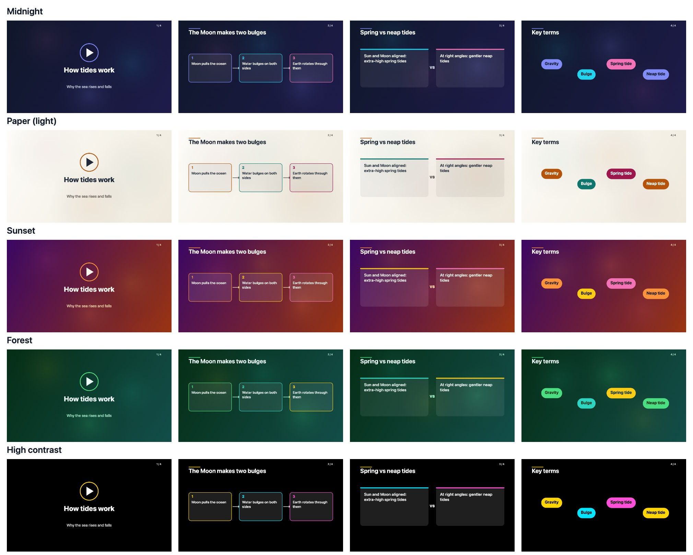

# Explain as Video

A Chrome (Manifest V3) extension that turns **highlighted web-page text** into a short **narrated, captioned explainer video** or a **themed slide deck**. It needs no paid APIs and no build step, and it has zero runtime dependencies.



**Flow:** select text → click the floating **Explain as video** button (or right-click → *Explain as video*, the toolbar icon, or <kbd>Alt</kbd>+<kbd>Shift</kbd>+<kbd>E</kbd>) → review/edit the text → **Generate video** or **Create slides**.

## Features

- **Demo mode** (the default) works offline with no API key. It builds the storyboard extractively from key sentences and keywords. Nothing leaves the browser.
- **Gemini mode** is optional and uses your own free-tier Google AI Studio key. It returns a structured JSON storyboard, and every field is validated before rendering.
- **Video player:** animated Canvas scenes (title, bullets, flow, compare, key terms, quote), narration with the browser's own `speechSynthesis`, caption chunks kept in sync with the voice, play/pause, previous/next/restart, speed, voice picker, narration and caption toggles, a clickable scene list, and keyboard shortcuts.
- **Create slides:** the same storyboard shown as finished slides, with 5 themes (Midnight, Paper, Sunset, Forest, High contrast), thumbnails, speaker notes, full-screen presenting, PNG export (one slide or all), Print / Save as PDF, and a Markdown outline.
- **Exports:** storyboard `.json`, transcript `.txt`, captions `.vtt` and `.srt`, and a **silent** `.webm` (see below).

### Does the exported WebM have audio? **No.**

WebM export records the canvas with `canvas.captureStream()` + `MediaRecorder`, with captions burned into the picture. **It has no audio track.** Browser speech synthesis is played by the operating system's speech engine. It doesn't go through a media element or a Web Audio graph, so the extension has no `MediaStream` to record. Tab-audio capture is not a reliable way to get it either, and this MVP does not try it. If you need the voice in the file, use the `.vtt`/`.srt` captions, or record the player with a screen recorder that captures system audio. Export runs in real time, so keep the tab visible while it records.

## Install (load unpacked)

1. Clone the repo and run `git clone https://github.com/ShivanshSinghChauhan/explain-as-video.git` (or download the ZIP from GitHub and unzip it).
2. Open `chrome://extensions` in Chrome 116 or later.
3. Turn on **Developer mode** (top-right).
4. Click **Load unpacked** and choose the **`extension/`** folder, not the repo root.
5. The Settings tab opens. To see the floating button, tick **Show an "Explain as video" button** and approve Chrome's prompt, then **reload** any tabs that were already open.
6. Optional: pin the extension from the puzzle-piece menu.

The right-click menu, toolbar icon and shortcut work right away, with no extra permissions.

### Optional: use Gemini

1. Create a key at <https://aistudio.google.com/apikey>. Use a project **without billing** if you want it to stay free.
2. Open Settings → **Google Gemini API** → read the warnings → tick the acknowledgement → paste the key → **Test key** → **Save & enable Gemini**.
3. Chrome asks for permission to contact `generativelanguage.googleapis.com`. Without that permission, nothing can be sent.

Pricing and limits: see [docs/PRICING.md](docs/PRICING.md) (checked 2026-10-29 against official pages). The free tier isn't unlimited or guaranteed. Limits apply per Google project and can change.

## Privacy and security

| Topic | What the extension does |
|---|---|
| What is sent | Only the text you **review and confirm**, trimmed to 6,000 characters at a sentence boundary, plus a fixed prompt. It never sends the page URL, the rest of the page, or cookies (`credentials: 'omit'`, `no-referrer`). Demo mode sends nothing. |
| API key | Stored **unencrypted** in `chrome.storage.local` on this Chrome profile, and sent only in the `x-goog-api-key` header, never in a URL. Settings shows it masked. **Delete saved key** removes it and revokes the API permission. Don't use it on shared computers. |
| Free-tier data use | On the free tier, Google may use prompts and responses to improve its products, and human reviewers may read them. The review screen and Settings both say so. |
| Untrusted content | Page text and model output are treated as data. The prompt fences the text and neutralises delimiter injection. The model reply goes through strict schema validation (types, enums, lengths, scene count) with one retry if it's malformed. Everything is drawn with `canvas.fillText` or set through `textContent`. No `innerHTML`, `eval` or remote code, and the CSP is `script-src 'self'`. |
| Permissions | Required: `contextMenus`, `storage`, `activeTab`, `scripting`, so the install shows **no site-access warning**. Optional and requested only when you turn on that feature: all `http(s)` sites (floating button) and `generativelanguage.googleapis.com` (Gemini). |
| Floating button | Runs in a closed Shadow DOM. It reads only `getSelection()`, and only sends after you click. |

## Error handling

| Situation | Behaviour |
|---|---|
| No selection, or under 20 characters | The review screen explains why, and Generate stays disabled. A paste box is always available. |
| Selection over 6,000 characters | Trimmed at a sentence and the user is told. Input over 50,000 characters is capped before any processing. |
| `chrome://` pages, Web Store, some viewers | The review tab opens with "Chrome does not let extensions read this page… paste below". |
| Session expired (browser restarted) | A notice appears with the paste box. |
| 401/invalid key, 403, 404 model | A clear message with an **Open Settings** button. |
| 429 / quota | Shows the wait time from `RetryInfo`/`Retry-After`, with a countdown on Retry. Never retried automatically. Offers the demo fallback. |
| 5xx / timeout (30 s) | Retried once after 1.5 s, then reported. **Cancel** is available while waiting. |
| Malformed or cut-off model JSON, safety block | Retried once if malformed. Otherwise you get a specific message and the demo fallback. |
| No speech voices, or speech fails mid-play | Switches to timed captions-only playback with a notice. |
| WebM not supported | The export button is disabled with an explanation. |

## Develop and test

```bash
npm install
```

```bash
npm run verify
```

```bash
npm run test:e2e
```

```bash
npm run samples
```

- `npm run check` runs static checks: syntax of every file, manifest permissions and CSP, no HTML/eval sinks, no inline scripts, no hidden Unicode, and that every referenced file exists.
- `npm test` runs 58 Node unit tests (`node:test`, no dependencies): text handling, storyboard validation and malformed replies, prompt fencing, demo generator, captions/VTT/SRT/outline, the Gemini client with a mocked fetch (success, 400/401/403/404/429/5xx, timeout, network, cancel, malformed, safety, truncation), settings and themes.
- `npm run test:e2e` runs 11 Playwright tests that load the real extension into Chromium (Playwright 1.64.1). They cover: floating button → review → demo video → exports, hostile page text, short/long/expired input, Gemini with mocked network (request contents, key in header, cache on reload, 429, malformed, bad key, 5xx, hostile model output), slides and themes, and a real WebM recording checked for its EBML header. The E2E build (`.e2e-build/`) pre-grants the localhost and Gemini permissions, because automation can't click Chrome's permission prompts.
- `npm run samples` re-renders `docs/themes/*.jpg`.
- `npm run package` writes `dist/explain-as-video.zip` for the Chrome Web Store.

Manual checklist for real Chrome: [docs/MANUAL_TESTS.md](docs/MANUAL_TESTS.md).

## Project layout

```
extension/            ← load this folder in Chrome
  manifest.json
  src/background.js   service worker: menu, toolbar, shortcut, opt-in content script
  src/content.js      floating button (closed shadow DOM)
  src/lib/            pure modules: text, storyboard schema, prompt, demo, captions, Gemini client, settings
  src/player/         review/generate UI, canvas renderer + themes, playback engine, narrator, WebM recorder, slides
  src/options/        settings page with key/data warnings
tests/unit/           node:test suites
tests/e2e/            Playwright suite + fixture server
scripts/              static checks, icon + theme-sample generators
docs/                 pricing notes, manual tests, theme samples
```

## Known limitations

- The exported WebM is silent (see above). Export is real-time, and it gets choppy if the tab is hidden.
- The floating button runs only in the top frame. Selections inside iframes need the right-click menu.
- Demo mode is extractive, not real "understanding". It labels itself as such in the narration.
- Voice quality and the available voices depend on the OS and Chrome. "Online" voices may send narration text to the browser vendor.
- Gemini is the only live provider. Groq and others were left out because their free-tier terms couldn't be verified from public official pages on 2026-10-29.

## License

MIT
